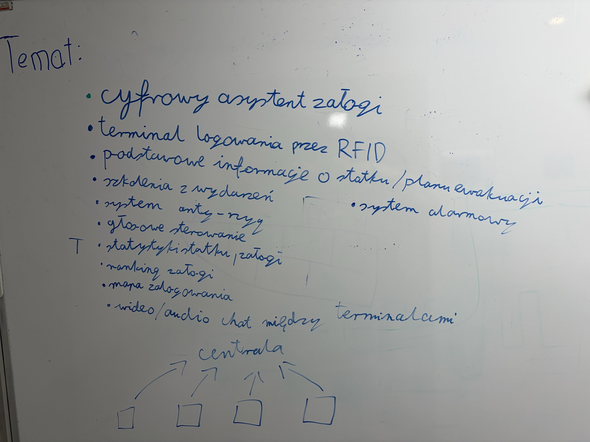

# Plan z tablicy (2026-11-19)

**Temat: cyfrowy asystent załogi**

| Funkcja z tablicy | Stan |
|---|---|
| Cyfrowy asystent załogi | ✔ zakładka Asystent (Mewka, czat + głos, Claude) |
| Terminal logowania przez RFID | ✘ do zrobienia |
| Podstawowe informacje o statku / plan ewakuacji | ✔ Statek 3D + Ewakuacja (model stylizowany) |
| Szkolenia z wydarzeń | ✔ częściowo: Ćwiczenia (7 scenariuszy, checklisty, dziennik) |
| System alarmowy | ✔ częściowo: sygnały w Ćwiczeniach; brak rozgłaszania alarmu na wszystkie terminale |
| System anty-rzyg (choroba morska?) | ✘ do ustalenia, co to ma robić |
| Głosowe sterowanie | ✔ częściowo: rozmowa głosowa z asystentem; brak komend sterujących aplikacją |
| Statystyki statku, załogi | ✘ |
| Ranking załogi | ✘ (np. z wyników ćwiczeń) |
| Mapa zalogowania | ✘ (kto przy którym terminalu / w której strefie) |
| Wideo/audio chat między terminalami | ✘ |
| Architektura: centrala + wiele terminali | ✘ obecnie jedna aplikacja bez serwera centralnego stanu |
